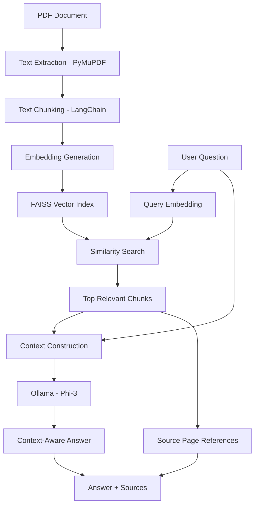

# ContextaAI – RAG-Powered Document Assistant

**ContextaAI** is a Retrieval-Augmented Generation (RAG) based AI document assistant that allows users to interact with PDF documents through natural language questions.

Instead of searching through lengthy documents manually, users can ask questions and receive context-aware answers generated using a Large Language Model (LLM). The system uses semantic search to retrieve relevant document passages and provides page-level source references to make responses easier to verify.

The project demonstrates an end-to-end RAG pipeline integrating document processing, text chunking, embedding generation, vector similarity search, and LLM-based response generation.

---

## Key Features

- **PDF Document Processing:** Extracts text and page information from PDF documents using PyMuPDF.
- **Intelligent Text Chunking:** Divides lengthy documents into smaller, overlapping text chunks for efficient retrieval.
- **Semantic Embeddings:** Converts document chunks and user queries into vector representations using Sentence Transformers.
- **Vector Similarity Search:** Uses FAISS to retrieve relevant document chunks based on semantic similarity.
- **Context-Aware Question Answering:** Generates answers using the retrieved context and the Phi-3 language model through Ollama.
- **Source Page References:** Identifies the document pages associated with retrieved information.
- **Session Management:** Maintains temporary document data and vector indexes in memory during a CLI session.
- **Interactive Frontend:** Provides a React-based interface for document upload and conversational interaction.

---

## System Architecture

The application follows a Retrieval-Augmented Generation architecture.



### RAG Pipeline

**1. Document Loading**

PDF documents are processed using PyMuPDF (`fitz`). Text is extracted page by page, preserving page numbers for source identification.

**2. Text Chunking**

The extracted text is divided into smaller chunks using LangChain's `RecursiveCharacterTextSplitter`.

Current configuration:

| Parameter | Value |
|---|---|
| Chunk Size | 500 characters |
| Chunk Overlap | 100 characters |

Overlapping chunks help preserve contextual continuity between adjacent text segments.

**3. Embedding Generation**

The Sentence Transformers model `all-MiniLM-L6-v2` converts document chunks into dense numerical vector representations.

The same embedding model is used to encode incoming user queries.

**4. Vector Database and Retrieval**

FAISS (`IndexFlatL2`) is used to store document embeddings and perform efficient similarity searches.

For every user query:
- Generate its embedding.
- Search the FAISS index.
- Retrieve the top 2 relevant chunks.
- Apply a distance threshold to filter less relevant results.

**5. LLM-Based Answer Generation**

The retrieved document chunks are combined with the user's question and passed to the Phi-3 model through Ollama.

The prompt instructs the model to:
- Use only the retrieved document context.
- Avoid introducing unsupported information.
- Provide complete and relevant answers.
- Indicate when the requested information is not available in the supplied context.

**6. Source Identification**

The page numbers associated with retrieved chunks are collected and returned alongside the generated answer.

---

## Technology Stack

| Technology | Purpose |
|---|---|
| Python | Core backend and RAG implementation |
| PyMuPDF | PDF text extraction |
| LangChain Text Splitters | Document chunking |
| Sentence Transformers | Semantic embedding generation |
| all-MiniLM-L6-v2 | Embedding model |
| FAISS | Vector indexing and similarity search |
| Ollama | Local LLM inference |
| Phi-3 (3.8B) | Answer generation |
| React | Frontend development |
| Vite | Frontend build tooling |
| Tailwind CSS | UI styling |

---

## Project Structure

```text
RAG-Document-Assistant/
│
├── backend/
│   ├── documents/
│   │   └── sample.pdf
│   │
│   ├── src/
│   │   ├── main.py
│   │   ├── document_loader.py
│   │   ├── text_splitter.py
│   │   ├── embeddings.py
│   │   ├── vector_store.py
│   │   ├── retriever.py
│   │   ├── llm.py
│   │   ├── session_manager.py
│   │   └── chunk_store.py
│   │
│   ├── app.py
│   └── requirements.txt
│
├── frontend/
│   ├── public/
│   ├── src/
│   │   ├── api/
│   │   │   └── ragApi.js
│   │   │
│   │   ├── components/
│   │   │   ├── Header.jsx
│   │   │   ├── FileUpload.jsx
│   │   │   ├── ChatBox.jsx
│   │   │   ├── ChatInput.jsx
│   │   │   ├── Message.jsx
│   │   │   ├── HowItWorks.jsx
│   │   │   ├── Footer.jsx
│   │   │   └── NoticeModal.jsx
│   │   │
│   │   ├── AboutProject.jsx
│   │   ├── App.jsx
│   │   └── main.jsx
│   │
│   ├── package.json
│   └── vite.config.js
│
└── README.md
```

---

## Getting Started

### Prerequisites

Make sure the following are installed:

- Python 3
- Node.js and npm (for the frontend)
- Ollama
- Git

### 1. Clone the Repository

```bash
git clone <YOUR-REPOSITORY-URL>
cd RAG-Document-Assistant
```

### 2. Set Up the Python Environment

Create and activate a virtual environment:

**Windows**

```bash
python -m venv venv
venv\Scripts\activate
```

**Linux / macOS**

```bash
python3 -m venv venv
source venv/bin/activate
```

Install the backend dependencies:

```bash
pip install -r backend/requirements.txt
```

### 3. Configure Ollama

Install Ollama from:

https://ollama.com/

Download the Phi-3 model:

```bash
ollama pull phi3:3.8b
```

Make sure the Ollama service is running before starting the application.

### 4. Run the RAG Application

Navigate to the backend source directory:

```bash
cd backend/src
```

Start the application:

```bash
python main.py
```

When prompted, provide the PDF document path.

For the included sample document:

```text
../documents/sample.pdf
```

The application will then:

1. Extract text from the PDF.
2. Generate document chunks.
3. Create embeddings.
4. Initialize the FAISS index.
5. Start accepting questions.

Ask questions about your document through the terminal.

To terminate the session:

```text
exit
```

### 5. Run the React Frontend

Open another terminal and navigate to the frontend directory:

```bash
cd frontend
```

Install dependencies:

```bash
npm install
```

Start the development server:

```bash
npm run dev
```

Open the local URL displayed by Vite, typically:

```text
http://localhost:5173
```

**Frontend integration note:** The React interface currently expects a backend exposing `POST /upload` and `POST /ask`. The API implementation is not included in the current backend source. The frontend also contains a hard-coded Cloudflare tunnel URL in `src/api/ragApi.js`. Configure this URL to point to your own compatible API server before expecting document upload and chat to work through the browser.

---

## Configuration

The primary RAG parameters can be adjusted in the corresponding backend modules.

| Component | Current Configuration |
|---|---|
| Embedding Model | `all-MiniLM-L6-v2` |
| LLM | `phi3:3.8b` |
| Chunk Size | 500 |
| Chunk Overlap | 100 |
| Retrieval Count (Top-K) | 2 |
| Similarity Metric | L2 Distance |
| Retrieval Threshold | 1.8 |

These parameters can be tuned depending on document size, retrieval quality, and available computing resources.

---

## Current Limitations

- PDF processing is the currently implemented document-loading workflow.
- Vector indexes and session data are maintained temporarily rather than through persistent database storage.
- Retrieval uses a fixed Top-K value and distance threshold.
- The command-line implementation is available, while the frontend API integration requires a compatible backend implementation.
- LLM response time depends on the hardware resources available for local inference.

---

## Future Improvements

- Complete FastAPI integration for frontend and backend communication.
- Support for multiple document formats such as DOCX and TXT.
- Multi-document question answering.
- Persistent vector storage and improved session management.
- Conversation history and contextual follow-up questions.
- Advanced retrieval strategies, including metadata filtering and reranking.
- Streaming LLM responses for a better user experience.
- Improved source attribution with relevant text snippets.
- Deployment with scalable backend infrastructure.

---

## Learning Outcomes

This project explores practical implementation of:

- Retrieval-Augmented Generation (RAG).
- Semantic search and vector embeddings.
- Document preprocessing and text chunking.
- FAISS-based vector similarity search.
- Integration of open-source LLMs using Ollama.
- End-to-end AI application development.
- React-based frontend development.

---

**ContextaAI – Making documents conversational through Retrieval-Augmented Generation.**
